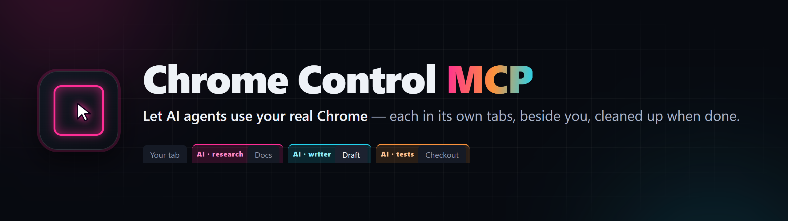
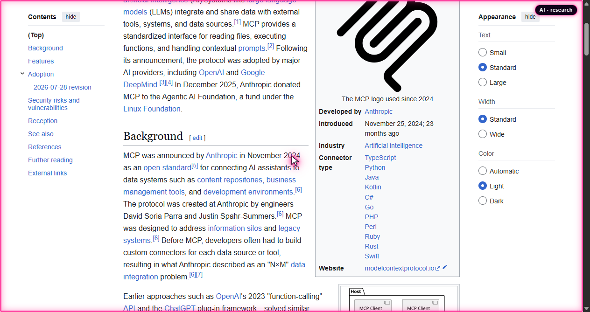
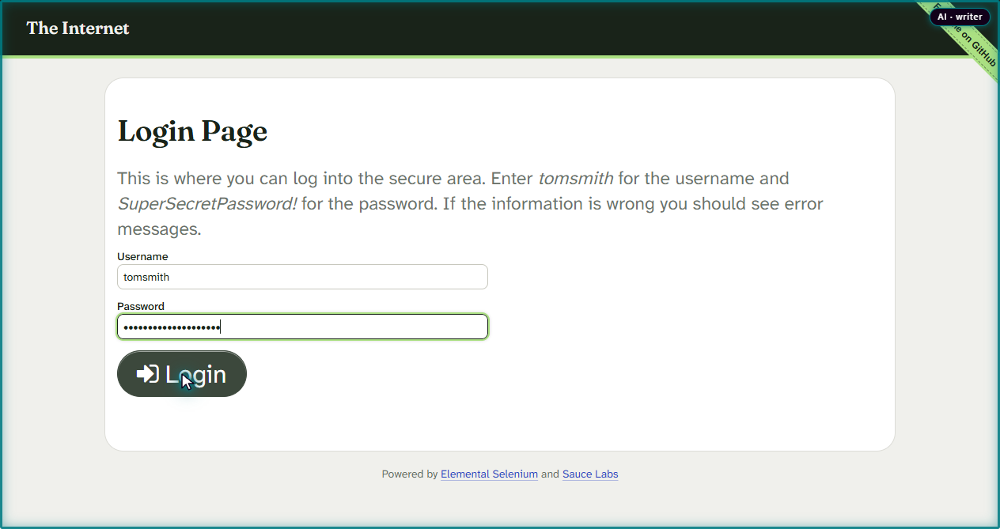
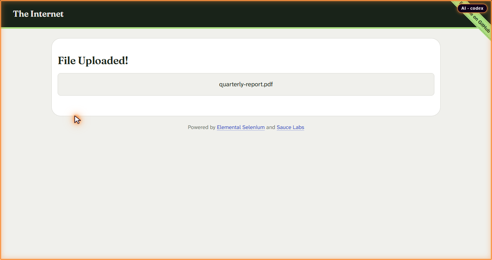
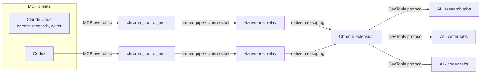

<p align="center">
  
</p>

<p align="center">
  <a href="https://github.com/RandyNorthrup/chrome-control-mcp/actions/workflows/quality.yml"></a>
  <a href="https://github.com/RandyNorthrup/chrome-control-mcp/releases/latest"></a>
  <a href="https://marketplace.visualstudio.com/items?itemName=RandyNorthrup.chrome-control-mcp"></a>
  <a href="https://marketplace.visualstudio.com/items?itemName=RandyNorthrup.chrome-control-mcp"></a>
  <a href="https://github.com/RandyNorthrup/chrome-control-mcp/releases"></a>
  <a href="https://github.com/RandyNorthrup/chrome-control-mcp/stargazers"></a>
  <a href="LICENSE"></a>
  
  
</p>

<p align="center">
  <b>A standalone Model Context Protocol server that lets AI agents drive the Chrome you already use</b><br>
  -- signed in as you, in tabs of their own, visibly, and without ever taking your screen.
</p>

<p align="center">
  <a href="#whats-new">What's new</a> ·
  <a href="#install">Install</a> ·
  <a href="#connect-any-mcp-client">Connect a client</a> ·
  <a href="#tools-at-a-glance">Tools</a> ·
  <a href="docs/TOOLS.md">Tool reference</a> ·
  <a href="docs/ARCHITECTURE.md">Architecture</a> ·
  <a href="docs/SECURITY.md">Security</a> ·
  <a href="docs/VERIFICATION.md">Verification</a>
</p>


<p align="center"><sub>One Chrome window, two MCP clients, three agents. Your own tab (left) stays yours; every agent's tabs sit in a group of their own colour, and the page carries the same colour, name and cursor. Captured from a live run of 1.8.1.</sub></p>

## What's new

| Version                                                                            | Released   | What changed                                                                                                                                                                                                                                                                             |
| ---------------------------------------------------------------------------------- | ---------- | ---------------------------------------------------------------------------------------------------------------------------------------------------------------------------------------------------------------------------------------------------------------------------------------- |
| [1.11.1](https://github.com/RandyNorthrup/chrome-control-mcp/releases/tag/v1.11.1) | 2026-11-07 | **A managed install no longer reports a registration mismatch.** A browser tool called before the extension attached told agents to re-register a server that was already registered; the note compared two spellings of the same file. Also builds from source with GCC 16 and Qt 6.12. |
| [1.11.0](https://github.com/RandyNorthrup/chrome-control-mcp/releases/tag/v1.11.0) | 2026-11-01 | **Large uploads.** `browser_upload` carries files up to 2 GiB -- a channel's long videos, not just documents -- straight from disk into the page a piece at a time. Set `CHROME_CONTROL_MCP_UPLOAD_MAX_MB` to change the bound.                                                          |
| [1.10.0](https://github.com/RandyNorthrup/chrome-control-mcp/releases/tag/v1.10.0) | 2026-11-01 | **Chrome profiles, chosen per call.** One server serves every profile you load the extension in -- work, personal, each person's. An agent opens its tab in the one it names, or the one you used last, and every call follows its tab; listings say which profile each tab is in.       |

Every release, with the day it shipped and what it changed, is in [CHANGELOG.md](CHANGELOG.md); each
release page has its downloads. To hear about new ones, use **Watch → Custom → Releases** on this
repository, or subscribe to the
[releases feed](https://github.com/RandyNorthrup/chrome-control-mcp/releases.atom). An agent can
check for you with `browser_update_check`, and install one with `browser_update_apply`.

## Highlights

|                                                                                                                                                                                                                  |                                                                                                                                                                                                             |
| ---------------------------------------------------------------------------------------------------------------------------------------------------------------------------------------------------------------- | ----------------------------------------------------------------------------------------------------------------------------------------------------------------------------------------------------------- |
| **Many agents, one browser.** Several editors, and several agents inside one, work at the same time. Each gets its own tabs and its own coloured group, and none can touch another's.                            | **Your tabs stay yours.** A tab you open -- even with Ctrl+T from an AI tab -- never joins an AI group. Drag a tab into a group to hand it over; drag it out to take it back.                               |
| **Works beside you.** Agents drive background tabs over the DevTools protocol and never bring them to the front; a tab an agent's click opens goes behind the one you are looking at. Your keyboard stays yours. | **Cleans up after itself.** `browser_release`, or the agent's editor exiting, closes the tabs it opened and removes its group. Tabs it borrowed are handed back, never closed.                              |
| **Uploads without dialogs.** File inputs, inputs a script creates, drop zones and `showOpenFilePicker` are all filled directly -- in background tabs, where Chrome would cancel a native dialog anyway.          | **Precise and semantic.** Accessibility snapshots with refs bound to their tab, real mouse and keyboard input, guarded coordinate clicks, and checks that refuse to act on a page that changed underneath.  |
| **Always visible.** Every tab an agent holds shows a frame, a named badge and a cursor in its group's colour. After ten idle minutes an agent's highlight and debugger come off its tabs until its next command. | **Any MCP client.** Claude Code, Codex, VS Code, Cursor, Claude Desktop -- anything that speaks MCP over stdio. The server tells every client how to share the browser through the standard `instructions`. |
| **A clipboard each.** Copy, cut and paste -- by key, by tool, or through a page's own copy buttons -- use the agent's own clipboard. Never yours, never another agent's, never the system's.                     | **Pastes like a person.** Any editor gets a real paste: text, formatting and images, through the same events your own Ctrl+V fires, with typed text as the fallback.                                        |

## Many agents, one browser

<table>
  <tr>
    <td width="33%"></td>
    <td width="33%"></td>
    <td width="33%"></td>
  </tr>
  <tr>
    <td align="center"><sub><b>AI · research</b> reads Wikipedia</sub></td>
    <td align="center"><sub><b>AI · writer</b> fills a login form</sub></td>
    <td align="center"><sub><b>AI · codex</b>, a second client, uploads a file -- no dialog</sub></td>
  </tr>
</table>

Each of these is a direct `browser_screenshot` from the same run as the window above, with
`include_control_overlay` turned on; screenshots an agent takes for itself leave the overlay out.

How it keeps agents apart, in the order they meet it:

1. **Its own tab.** An agent opens one with `browser_new_tab` -- optionally naming itself with
   `agent: "research"` -- and passes the returned `tab_id` to every call. Element refs from a
   snapshot are bound to the tab they came from, so one agent's snapshot never retargets another's
   click.
2. **Its own group.** Each agent's tabs share a tab group titled for it (or for its MCP client), in
   a colour no other live group has. A tab its own click opens joins the same group.
3. **Nobody else's tab.** A tab another session holds is refused by name, and `browser_tabs` marks
   it `controlled_by_other_session` rather than hiding it.
4. **Its own clipboard.** Copy, cut and paste keys, `browser_clipboard`, and a page's copy and paste
   buttons in its tabs use the agent's own clipboard; your clipboard is never read or written.
5. **Letting go.** `browser_release` (with `tab_id` to release only that agent's tabs, popups included) closes what the agent
   opened and hands back what it borrowed; `keep_open: true` leaves a page open for you. The tab
   you are looking at and the browser's last tab are never closed.

Two agents behind one server are isolated but take turns: one server carries one command at a
time. Separate servers -- separate editor windows or clients -- run in parallel. The design record
is [docs/MULTI_SESSION.md](docs/MULTI_SESSION.md).

**Chrome profiles.** Load the extension in each profile agents may use -- work, personal, each
person's -- and one server serves them all. An agent opens its tab in a profile by name
(`browser_new_tab` with `profile: "work"`), or in the one whose window you used last, and every
call with that `tab_id` goes there. `browser_tabs` names each tab's profile. A profile is called by
its account email, or a name you give it on the extension's options page (chrome://extensions →
Chrome Control MCP → Details → Extension options). A profile without the extension stays out of
reach.

**Stopping every agent at once:** click the extension's toolbar button while it is connected. Tabs
the agents opened are left open for you, tabs they borrowed are handed back, and the groups and
highlights come off. The button then reads "off", and nothing reconnects -- even after a browser
restart -- until you click it again.

File pickers are caught only while an agent's own command runs (and for 2 s after), so your own
clicks on an upload button still open the normal dialog. Folder pickers are not supported yet.

## Install

Two parts: the MCP server, which your client runs, and the Chrome extension the server drives.

### The server, for any MCP client

[Download the latest release](https://github.com/RandyNorthrup/chrome-control-mcp/releases/latest)
for Windows x64, Linux x64, Apple silicon macOS or Intel macOS -- the release page's Downloads
table says which file is yours -- verify its SHA-256 against `SHA256SUMS.txt`, unpack it, and run:

```shell
# Windows
.\chrome_control_mcp.exe --install

# Linux / macOS
./chrome_control_mcp --install
```

That installs the server where it can update itself and prints the command path to give your
client, plus the folder to load into Chrome. Both stay the same through every later update. The
archives are deliberately unsigned; the [release guide](docs/RELEASES.md) covers verification and
platform warnings. Then [connect your client](#connect-any-mcp-client).

### Or, in VS Code, from the Marketplace

```shell
code --install-extension RandyNorthrup.chrome-control-mcp
```

The same server, packaged for VS Code: on first activation the extension installs it as above and
registers it with VS Code's own MCP support, so there is no `mcp.json` to edit. Marketplace updates
and the server's own updater land in the same install, and from 1.8.0 on an older copy never rolls a
newer one back.

### Load the extension into Chrome (once)

Open `chrome://extensions`, turn on **Developer mode**, choose **Load unpacked**, and pick the
extension folder -- the path `--install` printed, or run **Chrome Control MCP: Show the Chrome
extension folder to load** in VS Code, which copies it for you.

This one step is manual by Chrome's design, not by omission: branded Chrome ignores
`--load-extension`, and policy installs need a Web Store listing this project deliberately does not
have. Updates reuse the same folder, so it is a one-time step, and from 1.9.0 on the extension
reloads itself after an update once no agent is using it. Coming from an older version, press reload
on it once (or restart Chrome). To let agents into another Chrome profile, load the same folder in
that profile too.

## Connect any MCP client

The server speaks MCP over stdio and opens no network listener. Point your client at the stable
command path that `--install` prints:

| Platform | Command path                                                                    |
| -------- | ------------------------------------------------------------------------------- |
| Windows  | `%LOCALAPPDATA%\Programs\ChromeControlMCP\current\chrome_control_mcp.exe`       |
| Linux    | `~/.local/share/ChromeControlMCP/app/current/chrome_control_mcp`                |
| macOS    | `~/Library/Application Support/ChromeControlMCP/app/current/chrome_control_mcp` |

**Claude Code**

```shell
claude mcp add --scope user chrome-control -- "<command path>"
```

**Codex CLI**

```shell
codex mcp add chrome-control -- "<command path>"
```

**Cursor, Windsurf, Claude Desktop, and other JSON-configured clients**

```json
{
  "mcpServers": {
    "chrome-control": { "command": "<command path>" }
  }
}
```

**VS Code** (GitHub Copilot and other chat extensions): the Marketplace extension registers the
server for you; or add the command path to `mcp.json` like any other client.

After an update, restart the server in your client (in Claude Code: `/mcp`, then reconnect) so it
runs the new build.

## Tools at a glance

All **53 tools** have strict JSON Schemas; the [tool reference](docs/TOOLS.md) documents each one.

| Group                  | Tools                                                                                                                                                                                                                                                                                |
| ---------------------- | ------------------------------------------------------------------------------------------------------------------------------------------------------------------------------------------------------------------------------------------------------------------------------------ |
| Look and read          | `browser_snapshot` `browser_read` `browser_screenshot` `browser_get_value` `browser_get_attribute` `browser_box` `browser_console` `browser_network` `browser_wait_for`                                                                                                              |
| Act on the page        | `browser_click` `browser_click_at` `browser_js_click` `browser_hover` `browser_drag` `browser_type` `browser_press_key` `browser_select` `browser_set_value` `browser_scroll` `browser_focus` `browser_reveal` `browser_media` `browser_dialog` `browser_upload` `browser_clipboard` |
| Navigate               | `browser_navigate` `browser_back` `browser_forward` `browser_reload`                                                                                                                                                                                                                 |
| Tabs and windows       | `browser_tabs` `browser_new_tab` `browser_select_tab` `browser_close_tab` `browser_group_tabs` `browser_ungroup_tabs` `browser_windows` `browser_window` `browser_release`                                                                                                           |
| Browser state, devices | `browser_cookies` `browser_storage` `browser_permission` `browser_http_auth` `browser_emulate` `browser_download` `browser_print`                                                                                                                                                    |
| Recording              | `browser_record_start` `browser_record_stop` -- a `.webm` of the agent's tab plus a `.timeline.json` of the commands that drove it                                                                                                                                                   |
| Setup and updates      | `browser_extension_install` `browser_extension_status` `browser_extension_uninstall` `browser_update_status` `browser_update_check` `browser_update_apply`                                                                                                                           |

## Staying up to date

Every release page is titled with what the release does, says the day it shipped, and ends with a
Downloads table saying which file is yours; [What's new](#whats-new) has the latest three and
[CHANGELOG.md](CHANGELOG.md) the rest. From any client:

```text
browser_update_status   where this build is installed, and which versions are present
browser_update_check    what the newest release is
browser_update_apply    download, verify and install it
```

Each version is installed into `<root>/versions/<version>`, and a `current` link -- a directory
junction on Windows, a symbolic link elsewhere -- is repointed at it, so a running server is never
overwritten. The client's command path, Chrome's extension folder and the native-messaging
registration all point through `current` and never change. Downloads are checked against the
SHA-256 published with the release.

Neither Chrome nor your editor reloads code under a running process. The MCP server in your client
picks up a new build when the client restarts it. The extension, from 1.9.0 on, reloads itself for
a newer installed copy as soon as no agent holds a tab and none has used it for 10 s, so it never
interrupts an agent's work.

Until both have, you are told. Whenever the server, the installed copy and the extension Chrome is
running disagree, your agent's next browser reply carries a note saying which is behind and the one
thing that fixes it -- reload the extension, restart the server, or install -- in any MCP client,
and `browser_extension_status` shows all three versions.

| Platform | Install root                                         |
| -------- | ---------------------------------------------------- |
| Windows  | `%LOCALAPPDATA%\Programs\ChromeControlMCP`           |
| Linux    | `~/.local/share/ChromeControlMCP/app`                |
| macOS    | `~/Library/Application Support/ChromeControlMCP/app` |

Set `CHROME_CONTROL_MCP_INSTALL_ROOT` to install somewhere else.

## How it works



One executable is both the MCP server and the native-messaging relay Chrome launches. Each server
publishes its own rendezvous record and gets its own relay; the one extension holds a session per
relay and a set of tabs per session, each with its own debugger attachment and page state. A relay
that is attached tells the extension within about a second when another server starts, without
starting a process to ask. More in [docs/ARCHITECTURE.md](docs/ARCHITECTURE.md).

## Security model

Full browser control is powerful, so the boundaries are explicit:

- The extension origin is pinned, the relay authenticates as the same user and the same executable,
  and every IPC message is size-limited and validated. Windows uses a current-user ACL-protected
  named pipe; Linux and macOS use a mode-`0600` Unix socket in a private directory with peer
  credentials.
- Stale element refs and screenshot coordinates are refused rather than retargeted, and payloads
  are bounded throughout.
- File uploads are read by the server, never by the page, up to 2 GiB a file unless
  `CHROME_CONTROL_MCP_UPLOAD_MAX_MB` says otherwise, and can be confined with
  `CHROME_CONTROL_MCP_UPLOAD_ROOTS`.

For inspection-only use:

```text
CHROME_CONTROL_MCP_SECURITY_PROFILE=read_only
CHROME_CONTROL_MCP_REDACT_SENSITIVE_OUTPUT=true
```

The read-only profile exposes 14 tools -- 11 that look at the browser plus extension status and the
two update checks -- and independently refuses any hidden mutating call. The extension's
permissions, and why each is needed, are in [docs/SECURITY.md](docs/SECURITY.md).

## Verification

Measured for 1.9.0 on 2026-10-31, except the two rows marked 1.8.0, whose code later releases leave alone:

| Check                                                                                                                | Result                          |
| -------------------------------------------------------------------------------------------------------------------- | ------------------------------- |
| ctest suites -- MSVC, GCC and Clang, warnings as errors                                                              | Windows 24/24, Linux 23/23      |
| `clang-tidy`, exhaustive `cppcheck`, Semgrep, ASan + UBSan, TSan                                                     | clean                           |
| Extension and tooling unit tests                                                                                     | 210/210                         |
| Full live browser suite (isolated Chrome for Testing 153)                                                            | 48 tools, 177 cases, all pass   |
| Multi-agent live suite: two servers, two agents behind one of them                                                   | 25/25                           |
| Per-agent clipboard live suite: a sentinel on the user's clipboard survives every agent copy, cut and paste          | 24/24                           |
| Extension version live suite: same version; an older one (told, reloads itself once, no loop); released 1.8.2        | 6/6, 12/12, 8/8                 |
| Live suites in CI on Windows, Linux and macOS                                                                        | pass                            |
| (1.8.0) Real-world run in an everyday Chrome profile: real sites, real uploads, popups, Trusted Types pages, cleanup | 23/23                           |
| (1.8.0) Reconnect attempts with no server running (process-spawn regression check)                                   | 6 in 75 s, unchanged from 1.7.0 |

```shell
npm run smoke
node tests/e2e/isolated_run.mjs --chrome=<Chrome for Testing> tests/e2e/multi_agent_e2e.mjs
```

Exact evidence and its limits are in [docs/VERIFICATION.md](docs/VERIFICATION.md).

## Build from source

Requirements: Windows 10/11 x64, Linux x64 or macOS; Google Chrome 116+; CMake 3.25+; Qt 6.5+
(Core, Network, Test); a C++20 compiler (Visual Studio 2022, GCC or Clang); Node.js 20.19+.

```shell
npm ci
npm run build             # or ./scripts/build.ps1 -Configuration Release
npm run extension -- install
```

The build uses warnings as errors and runs every native and extension unit suite. Output lands in
`build/Release/` on Windows and `build/` elsewhere, with the extension staged beside the
executable. Prefer the path `--install` prints over a build-directory path: only it survives an
update.

## Project identity

| Item         | Value                              |
| ------------ | ---------------------------------- |
| MCP server   | `chrome-control-mcp`               |
| Executable   | `chrome_control_mcp[.exe]`         |
| Extension    | `Chrome Control MCP`               |
| Extension ID | `iojehhmnaigcejfcpmilpclmeljhlkaa` |
| Native host  | `com.chromecontrolmcp.browser`     |

To retire it, run `npm run extension -- uninstall` (or `browser_extension_uninstall`), then remove
the extension at `chrome://extensions`.

## Thanks

Inflectra's [UI Test Automation Playground](http://uitestingplayground.com/)
([source](https://github.com/inflectra/ui-test-automation-playground)) and Elemental Selenium's
[The Internet](https://the-internet.herokuapp.com/) provide focused, practical browser scenarios.
Both have been invaluable for testing this project end to end.

## License

Released under the [MIT License](LICENSE). Copyright © 2026 Randy Northrup.

If this project saves you time, you can
[buy me a coffee](https://www.paypal.com/donate/?hosted_button_id=Q9VC7B42R7K82) via PayPal.
Thank you!
