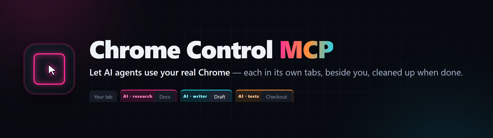
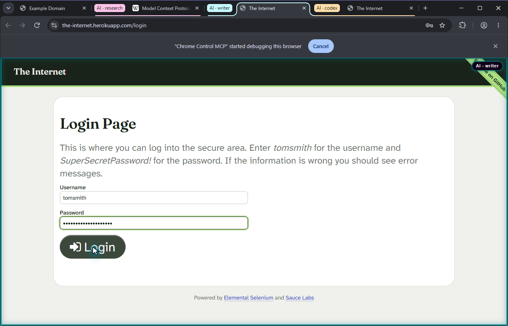

<p align="center">
  
</p>

**Let AI agents use the Chrome you already use -- signed in as you, in tabs of their own, visibly,
and without ever taking your screen.**

This extension installs the [Chrome Control MCP](https://github.com/RandyNorthrup/chrome-control-mcp)
server and registers it with VS Code, so its 53 tools are available to chat without editing an
`mcp.json` or knowing a path. The same server works with any MCP client -- Claude Code, Codex,
Cursor, Claude Desktop -- and several of them can share one browser at once.



## What it does

| Capability              | Included                                                                                                                                    |
| ----------------------- | ------------------------------------------------------------------------------------------------------------------------------------------- |
| Many agents at once     | Several editors, and several agents inside one, each in its own tabs and coloured tab group                                                 |
| Your tabs stay yours    | A tab you open never joins an AI group; drag a tab in to hand it over, out to take it back                                                  |
| Works beside you        | Drives background tabs and never brings them to the front; an agent's popup goes behind your tab                                            |
| Always visible          | A frame, a named badge and a cursor in the agent's colour on every tab it holds                                                             |
| Cleans up after itself  | `browser_release`, or the editor exiting, closes what the agent opened; borrowed tabs are handed back                                       |
| Uploads without dialogs | File inputs, script-created inputs, drop zones and `showOpenFilePicker`, filled directly in background tabs                                 |
| A clipboard each        | Copy, cut and paste use the agent's own clipboard, never yours or another agent's; pastes carry text, formatting and images into any editor |
| Semantic control        | Accessibility snapshots with element refs bound to the tab they came from                                                                   |
| Real input              | Click, type, keys, hover, drag, select, scroll, dialogs and media                                                                           |
| Browser state           | Cookies, storage, permissions, downloads, print, HTTP auth, emulation, and tab recording to `.webm`                                         |
| In-place updates        | The server updates itself without overwriting the copy that is running                                                                      |

The server talks to your ordinary Chrome through native messaging and the Chrome DevTools Protocol.
It opens no network listener, and nothing leaves your machine.

## Setup

Installing this extension does the first two steps for you:

1. **The server is installed** into a per-user directory on first activation. Nothing needs
   administrator rights.
2. **VS Code is told about it** through the MCP server definition provider API, so no
   configuration file needs editing.
3. **Chrome has to be pointed at the extension folder once, by you.** Run **Chrome Control MCP:
   Show the Chrome extension folder to load** from the command palette: it copies the folder path
   and opens it. Then in Chrome open `chrome://extensions`, turn on **Developer mode**, choose
   **Load unpacked**, and pick that folder.

**That third step cannot be automated, and this extension does not pretend otherwise.** Branded
Chrome ignores `--load-extension`, and installing by enterprise policy needs a Web Store listing
and a signed package, which this project deliberately does not have. It is a one-time step:
updates reuse the same folder.

## Using it with several agents

Each agent should open its own tab with `browser_new_tab` -- optionally with a short `agent` name,
which gives its tabs their own coloured group -- and pass the returned `tab_id` to every call. The
server tells every client this itself, through the standard MCP `instructions`. When an agent is
done it calls `browser_release`: tabs it opened close, tabs it borrowed are handed back.

## Updating

Marketplace updates and the server's own updater (`browser_update_check`, then
`browser_update_apply`) converge on the same install, and from 1.8.0 on an older copy never rolls a
newer one back. Each version is installed into its own directory behind a stable link, so the
editor's server command, Chrome's extension folder and the native-messaging registration never
change.

After an update, reload VS Code and press reload on the extension at `chrome://extensions` so both
run the new build.

## Commands

| Command                                                 | What it does                                                   |
| ------------------------------------------------------- | -------------------------------------------------------------- |
| Chrome Control MCP: Repair install                      | Reinstalls and re-registers the server and native host         |
| Chrome Control MCP: Show the Chrome extension folder... | Copies and opens the folder to load into `chrome://extensions` |

## Security

The server pins the extension origin, authenticates the same-user, same-executable relay, limits
and validates every IPC message, refuses stale element refs and screenshot coordinates, and exposes
strict JSON Schemas. Windows uses a current-user ACL-protected named pipe; Linux and macOS use a
mode-`0600` Unix socket in a private directory with peer credentials.

For inspection-only use, set these in the server environment:

```text
CHROME_CONTROL_MCP_SECURITY_PROFILE=read_only
CHROME_CONTROL_MCP_REDACT_SENSITIVE_OUTPUT=true
```

The read-only profile exposes 14 tools and independently refuses hidden mutating calls.

## Requirements

- Google Chrome 116 or later
- Windows x64, Linux x64, or macOS (Apple silicon or Intel)

Builds are intentionally unsigned and unnotarized; this project has no signing key and does not
need one.

## Links

[Repository](https://github.com/RandyNorthrup/chrome-control-mcp) ·
[Tool reference](https://github.com/RandyNorthrup/chrome-control-mcp/blob/main/docs/TOOLS.md) ·
[Security](https://github.com/RandyNorthrup/chrome-control-mcp/blob/main/docs/SECURITY.md) ·
[Verification](https://github.com/RandyNorthrup/chrome-control-mcp/blob/main/docs/VERIFICATION.md)

Released under the MIT License. Copyright © 2026 Randy Northrup.
